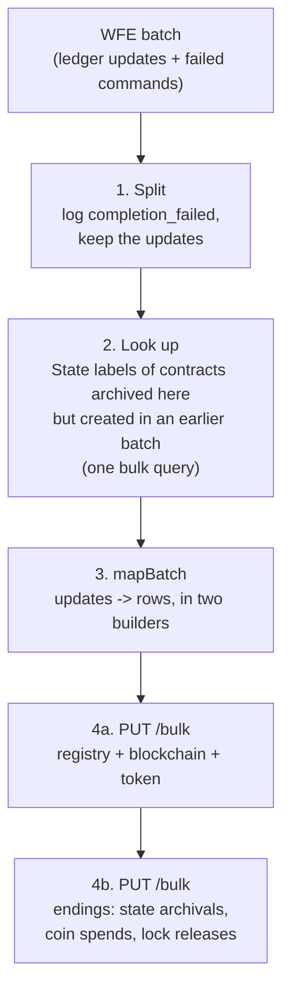

# Canton CIP-56 Indexer

Indexes Canton ledger updates (CIP-56 Holdings and TransferInstructions) into the Kaleido
Token Subledger: blockchain evidence (transactions, events, states), registry (parties,
wallets, assets) and token rows (tokens, coins, locks, transfers).

## Batch pipeline



The endings go in a second request because the subledger handles an ending before its
parent within one request: an archive of a contract created in the same batch would fail.

## Files

```
src/canton/
  indexer.ts       the event processor: setup (chain + stream) and processBatch
  helpers.ts       CIP-56 view parsing, amount scaling, event predicates
  types.ts         connector-sdk type re-exports
src/subledger/
  mapping.ts       updates -> subledger rows (names, facts, mapBatch)
  client.ts        429 retry, ensureChain, State lookup by contract id
```

## Contract facts

Every created contract becomes a State. Its labels carry what a later archive needs, so no
cache is kept between batches:

| Contract | Labels |
|----------|--------|
| Holding | `kind=holding`, `owner`, `admin`, `instrumentId`, `amount`, `locked` |
| TransferInstruction | `kind=transfer-instruction`, `sender`, `receiver`, `admin`, `instrumentId`, `amount` |
| anything else | `kind=contract` |

plus `template` and `module`. A Transfer made by an update that exercised a
TransferInstruction carries its contract id as the `transferInstruction` label.
